# AI-Based Spacecraft Mission Success Analysis and Prediction

## Machine Learning, Deep Learning, Artificial Immune System (AIS), and Particle Swarm Optimization (PSO)

An AI-based data analysis and experimental forecasting project that examines historical spacecraft mission success rates using Machine Learning (ML), Deep Learning (DL), Artificial Immune System (AIS), and Particle Swarm Optimization (PSO).

The project analyzes annual spacecraft mission statistics, visualizes historical trends, compares model training performance, and generates exploratory forecasts for future mission success rates.

> **Important:** The dataset contains only five annual observations (2020–2024). Consequently, model evaluation is limited to training performance, and future predictions should be interpreted as experimental projections rather than validated forecasts.

---

## Table of Contents

1. [Project Overview](#project-overview)
2. [Problem Statement](#problem-statement)
3. [Project Objectives](#project-objectives)
4. [Dataset Description](#dataset-description)
5. [Technologies Used](#technologies-used)
6. [Algorithms Implemented](#algorithms-implemented)
7. [System Architecture](#system-architecture)
8. [Project Structure](#project-structure)
9. [Installation](#installation)
10. [Execution](#execution)
11. [Methodology](#methodology)
12. [Mathematical Formulation](#mathematical-formulation)
13. [Model Evaluation](#model-evaluation)
14. [Results and Visualizations](#results-and-visualizations)
15. [Generated Output Files](#generated-output-files)
16. [Applications](#applications)
17. [Limitations](#limitations)
18. [Future Scope](#future-scope)
19. [Conclusion](#conclusion)
20. [License](#license)

---

# Project Overview

Spacecraft missions are important for scientific research, technological advancement, communication, navigation, and space exploration.

Analyzing historical spacecraft mission data can help researchers understand mission success trends and identify changes in mission performance over time.

This project develops an AI-assisted analytical system using Python and optimization algorithms.

The system performs:

- Historical spacecraft mission data analysis
- Data preprocessing and feature engineering
- Mission success and failure rate calculation
- Machine learning model training
- Deep learning model training
- Artificial Immune System optimization
- Particle Swarm Optimization
- Model performance comparison
- Experimental future success-rate forecasting
- Data visualization and result generation

The project combines conventional machine learning with bio-inspired and swarm-intelligence optimization techniques.

---

# Problem Statement

Spacecraft missions involve complex engineering systems, significant investments, and operational risks.

Understanding mission success patterns is valuable for evaluating historical performance.

However, spacecraft mission data may be limited, irregular, or incomplete.

The objective of this project is to analyze historical mission success rates and explore how machine learning and optimization algorithms can model annual mission performance.

The project investigates the following questions:

1. How have spacecraft mission success rates changed over time?
2. What is the historical relationship between mission counts and success rates?
3. How closely can different models fit the observed success rates?
4. Can AIS optimize the parameters of a regression model?
5. Can PSO optimize regression coefficients?
6. How do conventional ML, DL, AIS, and PSO compare on training data?
7. What experimental future trends do the fitted models produce?

---

# Project Objectives

The main objectives are:

### 1. Historical Mission Analysis

Analyze spacecraft mission statistics from 2020 to 2024.

### 2. Data Preprocessing

Clean the dataset, extract year information, handle missing values, and calculate mission success rates.

### 3. Machine Learning

Implement Random Forest Regression to model historical mission success rates.

### 4. Deep Learning

Develop a feedforward Artificial Neural Network using TensorFlow/Keras.

### 5. Artificial Immune System

Apply a Clonal Selection Algorithm to optimize polynomial regression coefficients.

### 6. Particle Swarm Optimization

Apply swarm intelligence to optimize polynomial regression parameters.

### 7. Model Comparison

Compare the training errors and fitted values produced by different algorithms.

### 8. Experimental Forecasting

Generate exploratory spacecraft mission success-rate forecasts for 2025–2030.

### 9. Visualization

Create and save graphs, correlation heatmaps, comparison plots, and CSV reports.

---

# Dataset Description

## Dataset File

`RS_Session_266_AU_2850_2.csv`

## Dataset Period

2020–2024

The 2024 observation is reported up to December 10, 2024.

## Historical Mission Statistics

| Year | Total Missions | Successful Missions | Failed Missions | Success Rate |
|------|----------------|---------------------|-----------------|--------------|
| 2020 | 3 | 3 | 0 | 100% |
| 2021 | 1 | 0 | 1 | 0% |
| 2022 | 6 | 6 | 0 | 100% |
| 2023 | 4 | 4 | 0 | 100% |
| 2024 | 4 | 4 | 0 | 100% |
| **Total** | **18** | **17** | **1** | **94.44%** |

## Dataset Attributes

| Attribute | Description |
|-----------|-------------|
| Year | Year of mission reporting |
| Total_Missions | Total spacecraft missions |
| Successful_Missions | Number of successful missions |
| Failed_Missions | Number of failed missions |
| Success_Rate | Percentage of successful missions |
| Failure_Rate | Percentage of failed missions |

## Dataset Summary

- Total annual records: 5
- Total spacecraft missions: 18
- Successful missions: 17
- Failed missions: 1
- Overall historical success rate: 94.44%

The overall success rate is calculated using the total number of successful missions divided by the total number of missions.

It is not the unweighted average of annual success rates.

---

# Technologies Used

## Programming Language

- Python 3

## Libraries and Frameworks

| Technology | Purpose |
|------------|---------|
| Python | Core programming |
| Pandas | Dataset manipulation |
| NumPy | Numerical calculations |
| Matplotlib | Data visualization |
| Seaborn | Correlation heatmaps |
| Scikit-learn | Machine learning and evaluation |
| TensorFlow | Deep learning |
| Keras | Neural network development |
| Joblib | Model serialization |
| PyYAML | Configuration management |
| JSON | Model metadata |
| HDF5 | Neural network storage |

## Development Environment

- Visual Studio Code
- Python
- Windows
- Command Prompt or PowerShell

---

# Algorithms Implemented

## 1. Random Forest Regression

Random Forest is an ensemble machine learning algorithm that combines multiple decision trees.

Each decision tree learns relationships between input features and the target variable.

The final prediction is obtained by averaging predictions from individual trees.

### Configuration

- Algorithm: RandomForestRegressor
- Number of estimators: 100
- Maximum depth: 3
- Random state: 42

### Advantages

- Handles nonlinear relationships
- Reduces variance through ensembling
- Requires relatively little feature scaling
- Provides a useful experimental baseline

### Limitation

Random Forest does not naturally extrapolate trends beyond its training range.

---

## 2. Deep Learning

The project implements a feedforward Artificial Neural Network using TensorFlow/Keras.

### Neural Network Architecture

Input Layer

↓

Dense Layer: 64 Neurons, ReLU

↓

Dense Layer: 32 Neurons, ReLU

↓

Dense Layer: 16 Neurons, ReLU

↓

Output Layer: 1 Neuron, Linear Activation

### Configuration

- Optimizer: Adam
- Learning rate: 0.001
- Loss function: Mean Squared Error
- Maximum epochs: 500
- Batch size: 2
- Early stopping: Enabled

### Advantages

- Can represent nonlinear relationships
- Supports gradient-based optimization
- Can be extended to larger datasets

### Limitation

A neural network trained on only five annual observations is highly susceptible to overfitting and unstable extrapolation.

---

## 3. Artificial Immune System (AIS)

Artificial Immune System is a bio-inspired optimization approach based on principles of biological immune systems.

This project uses the Clonal Selection Algorithm (CLONALG).

### AIS Working Principle

1. Initialize a population of antibodies.
2. Evaluate the fitness of each antibody.
3. Select the best antibodies.
4. Generate clones.
5. Apply affinity-dependent hypermutation.
6. Replace weaker candidates.
7. Repeat until the maximum generation count is reached.

Each antibody represents the coefficients of a polynomial regression model.

### AIS Parameters

| Parameter | Value |
|-----------|-------|
| Population Size | 60 |
| Generations | 250 |
| Selected Antibodies | 12 |
| Clones per Antibody | 8 |
| Mutation Rate | 0.15 |
| Random Replacements | 8 |
| Polynomial Degree | 2 |
| Regularization | 0.01 |

### Advantages

- Population-based optimization
- Supports exploration of candidate solutions
- Uses mutation to maintain search diversity
- Does not require gradient calculations

---

## 4. Particle Swarm Optimization (PSO)

Particle Swarm Optimization is a swarm-intelligence optimization algorithm inspired by collective movement.

Each particle represents a possible solution.

Particles update their positions according to their personal best solution and the global best solution.

### PSO Working Principle

1. Initialize particle positions and velocities.
2. Evaluate the fitness of each particle.
3. Update personal best positions.
4. Update global best position.
5. Calculate new particle velocities.
6. Update particle positions.
7. Repeat until the maximum iteration count is reached.

### PSO Parameters

| Parameter | Value |
|-----------|-------|
| Number of Particles | 60 |
| Maximum Iterations | 250 |
| Inertia Weight | 0.7 |
| Cognitive Coefficient | 1.5 |
| Social Coefficient | 1.5 |
| Polynomial Degree | 2 |
| Regularization | 0.01 |
| Lower Bound | -200 |
| Upper Bound | 200 |

### Advantages

- Simple optimization mechanism
- Gradient-free optimization
- Tracks local and global best solutions
- Suitable for continuous parameter optimization

---

# System Architecture

```text
                  SPACECRAFT DATASET
                          |
                          v
                    DATA LOADING
                          |
                          v
                   PREPROCESSING
                          |
                          v
                  FEATURE ENGINEERING
                          |
                          v
                  MODEL DEVELOPMENT
                          |
          +---------------+---------------+
          |               |               |
          v               v               v
     MACHINE LEARNING    AIS             PSO
          |               |               |
          v               v               v
     RANDOM FOREST   CLONAL SELECTION  SWARM SEARCH
          |
          v
     DEEP LEARNING
          |
          +---------------+---------------+
                          |
                          v
                  MODEL EVALUATION
                          |
                          v
                 EXPERIMENTAL FORECAST
                          |
                          v
                   VISUALIZATION
                          |
                          v
                    CSV RESULTS
                          |
                          v
                    FINAL REPORTS
```

---

# Project Structure

```text
AI-Based Spacecraft Mission Success Analysis and Prediction/
│
├── README.md
│
├── RS_Session_266_AU_2850_2.csv
│
├── train_spacecraft_model.py
├── spacecraft_visualization.py
├── ais_spacecraft_analysis.py
├── pso_spacecraft_analysis.py
│
├── spacecraft_model.h5
├── spacecraft_model.pkl
├── spacecraft_scaler.pkl
├── config.yaml
├── metadata.json
│
├── accuracy_graph.png
├── heatmap.png
├── comparison_graph.png
├── result.csv
├── result_graph.png
├── prediction.csv
├── prediction_graph.png
├── model_comparison_metrics.csv
│
├── ais_model.pkl
├── ais_config.yaml
├── ais_metadata.json
├── ais_accuracy_graph.png
├── ais_heatmap.png
├── ais_comparison_graph.png
├── ais_result.csv
├── ais_result_graph.png
├── ais_prediction.csv
├── ais_prediction_graph.png
├── ais_model_comparison_metrics.csv
│
├── pso_model.pkl
├── pso_config.yaml
├── pso_metadata.json
├── pso_accuracy_graph.png
├── pso_heatmap.png
├── pso_comparison_graph.png
├── pso_result.csv
├── pso_result_graph.png
├── pso_prediction.csv
├── pso_prediction_graph.png
└── pso_model_comparison_metrics.csv
```

---

# Installation

## Step 1: Install Python

Install a compatible Python 3 version from:

https://www.python.org/downloads/

Verify installation:

```bash
python --version
```

## Step 2: Navigate to Project Directory

```cmd
cd "C:\Users\sagni\Downloads\AI-Based Spacecraft Mission Success Analysis and Prediction"
```

## Step 3: Create Virtual Environment

```bash
python -m venv venv
```

Activate the environment on Windows:

```cmd
venv\Scripts\activate
```

## Step 4: Install Dependencies

```bash
pip install pandas numpy matplotlib seaborn scikit-learn tensorflow joblib pyyaml h5py
```

---

# Execution

## 1. Train Machine Learning and Deep Learning Models

```bash
python train_spacecraft_model.py
```

This script generates:

- spacecraft_model.pkl
- spacecraft_model.h5
- spacecraft_scaler.pkl
- config.yaml
- metadata.json

## 2. Generate Machine Learning Visualizations

```bash
python spacecraft_visualization.py
```

This script generates:

- accuracy_graph.png
- heatmap.png
- comparison_graph.png
- result.csv
- result_graph.png
- prediction.csv
- prediction_graph.png
- model_comparison_metrics.csv

## 3. Run Artificial Immune System

```bash
python ais_spacecraft_analysis.py
```

This script optimizes polynomial regression coefficients using the Clonal Selection Algorithm.

All output files use the `ais_` prefix.

## 4. Run Particle Swarm Optimization

```bash
python pso_spacecraft_analysis.py
```

This script optimizes polynomial regression coefficients using Particle Swarm Optimization.

All output files use the `pso_` prefix.

---

# Methodology

## Phase 1: Data Collection

The spacecraft mission dataset is loaded from the CSV file.

## Phase 2: Data Preprocessing

The preprocessing pipeline includes:

- Column-name standardization
- Year extraction
- Numeric conversion
- Missing-value removal
- Duplicate removal
- Chronological sorting

## Phase 3: Feature Engineering

The following metrics are calculated:

- Success Rate
- Failure Rate

Year is used as the predictive input feature.

For AIS and PSO, polynomial year features are constructed.

## Phase 4: Model Training

Four approaches are investigated:

1. Random Forest Regression
2. Deep Learning
3. AIS-Optimized Polynomial Regression
4. PSO-Optimized Polynomial Regression

## Phase 5: Model Evaluation

Training predictions are compared with historical observations.

The following metrics are calculated:

- Mean Absolute Error
- Mean Squared Error
- Root Mean Squared Error
- R-squared

## Phase 6: Experimental Forecasting

The fitted models generate projections for:

- 2025
- 2026
- 2027
- 2028
- 2029
- 2030

These are experimental forecasts and have not been validated against independent future observations.

## Phase 7: Visualization

Graphs are generated using Matplotlib and Seaborn.

## Phase 8: Result Export

Results are saved as:

- PNG
- CSV
- PKL
- H5
- YAML
- JSON

---

# Mathematical Formulation

## 1. Mission Success Rate

Success Rate (%) =

```text
(Successful Missions / Total Missions) × 100
```

## 2. Mission Failure Rate

Failure Rate (%) =

```text
(Failed Missions / Total Missions) × 100
```

## 3. Polynomial Regression

AIS and PSO optimize the coefficients of:

```text
y = a + bx + cx²
```

Where:

- y = Predicted mission success rate
- x = Centered and scaled year
- a = Intercept
- b = Linear coefficient
- c = Quadratic coefficient

Predictions are constrained to the interval 0–100%.

## 4. AIS and PSO Fitness Function

```text
Fitness = MSE + λ × Sum(Squared Non-Intercept Coefficients)
```

Where:

- MSE = Mean Squared Error
- λ = Regularization coefficient

The optimization objective is to minimize fitness.

## 5. PSO Velocity Update

```text
v(t+1) = w × v(t)
       + c1 × r1 × (pbest - x(t))
       + c2 × r2 × (gbest - x(t))
```

Where:

- w = Inertia weight
- c1 = Cognitive coefficient
- c2 = Social coefficient
- r1, r2 = Random numbers
- pbest = Personal best position
- gbest = Global best position

## 6. PSO Position Update

```text
x(t+1) = x(t) + v(t+1)
```

---

# Model Evaluation

## Mean Absolute Error (MAE)

```text
MAE = (1/n) × Σ |Actual - Predicted|
```

MAE measures the average absolute difference between observed and predicted success rates.

Lower MAE indicates a closer fit.

## Mean Squared Error (MSE)

```text
MSE = (1/n) × Σ (Actual - Predicted)²
```

MSE gives greater weight to larger errors.

## Root Mean Squared Error (RMSE)

```text
RMSE = √MSE
```

RMSE measures prediction error in percentage points.

## R-Squared Score

```text
R² = 1 - (SS_res / SS_tot)
```

R-squared describes the proportion of observed variation explained by the fitted model.

R-squared is not equivalent to classification accuracy.

## Model Comparison

| Model | MAE | RMSE | R² |
|-------|-----|------|----|
| Random Forest | Generated at runtime | Generated at runtime | Generated at runtime |
| Deep Learning | Generated at runtime | Generated at runtime | Generated at runtime |
| AIS | Generated at runtime | Generated at runtime | Generated at runtime |
| PSO | Generated at runtime | Generated at runtime | Generated at runtime |

All reported metrics are training metrics.

A larger dataset and independent evaluation would be required to determine which method generalizes best.

---

# Results and Visualizations

## 1. Machine Learning Training Performance

The following graph compares the training errors of Random Forest and Deep Learning.

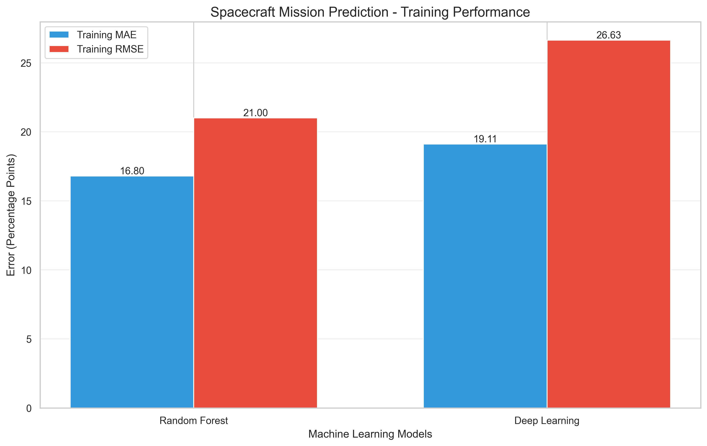

**Figure 1:** Random Forest and Deep Learning training MAE and RMSE.

Lower training errors indicate a closer fit to the available historical data.

They do not establish future prediction accuracy.

## 2. Dataset Correlation Heatmap

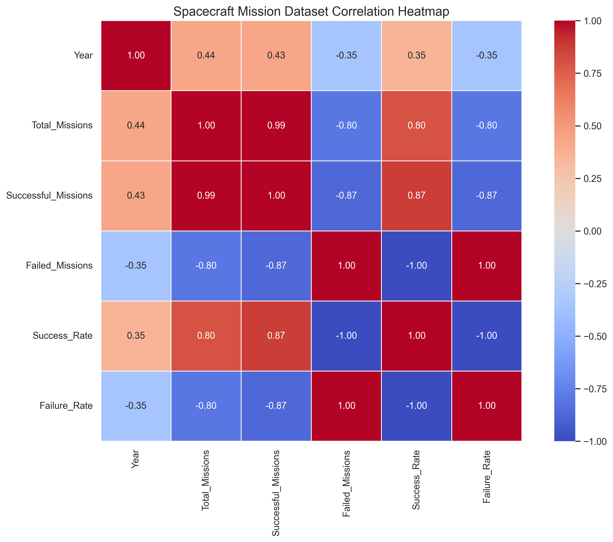

**Figure 2:** Correlation matrix showing relationships among mission statistics.

Because the dataset contains only five annual observations, the correlations should be interpreted cautiously.

## 3. Actual vs Predicted Success Rates

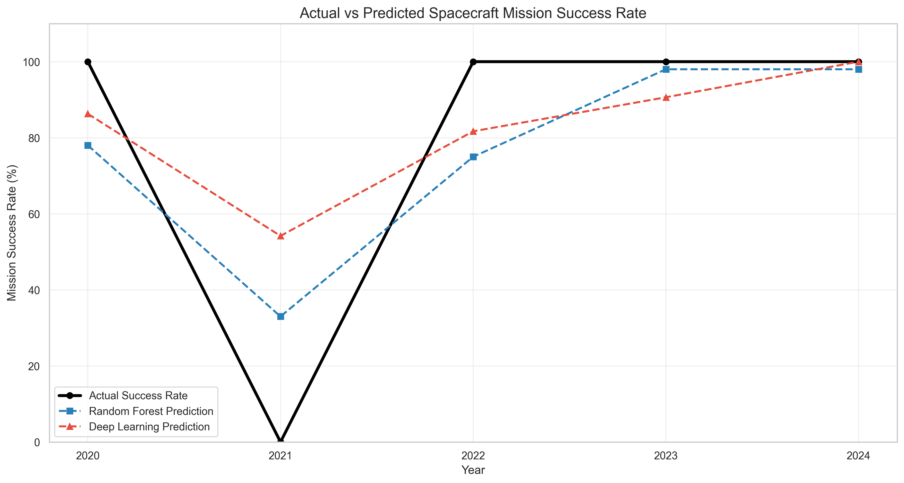

**Figure 3:** Historical mission success rates compared with fitted model predictions.

## 4. Historical Mission Results

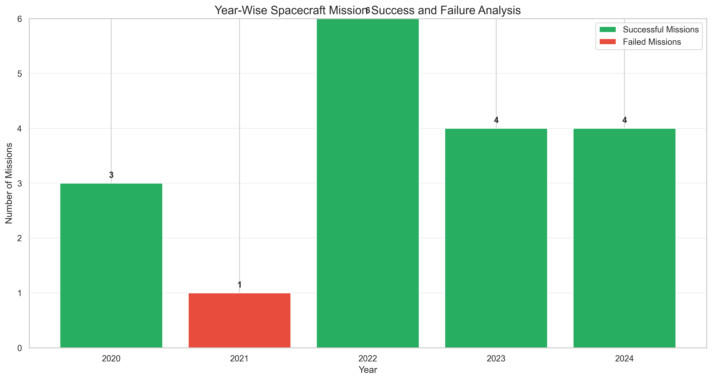

**Figure 4:** Annual successful and failed spacecraft mission counts.

## 5. Experimental Future Predictions

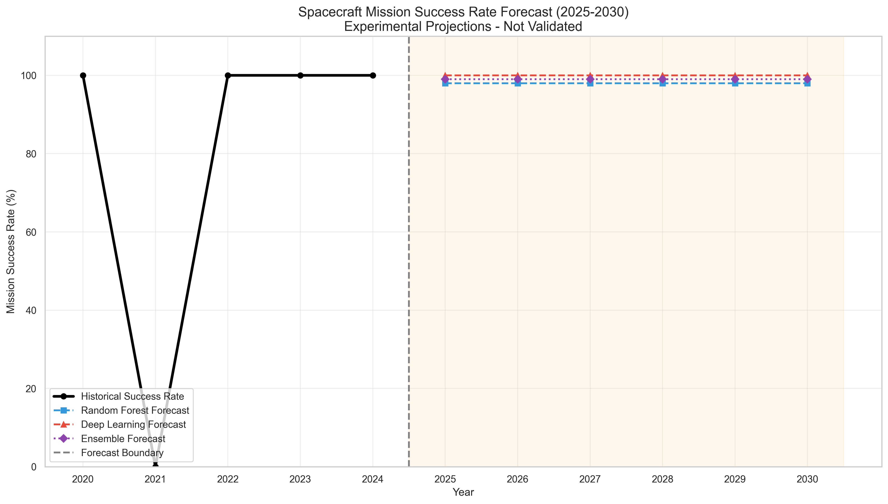

**Figure 5:** Historical spacecraft mission success rates and experimental forecasts for 2025–2030.

The forecasted values are model-generated estimates, not verified future outcomes.

---

# AIS Results and Visualizations

## AIS Optimization Performance

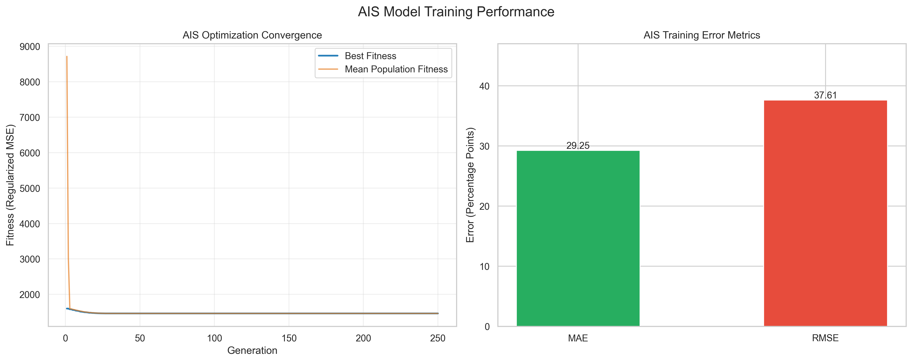

**Figure 6:** AIS optimization convergence and training error metrics.

## AIS Correlation Heatmap

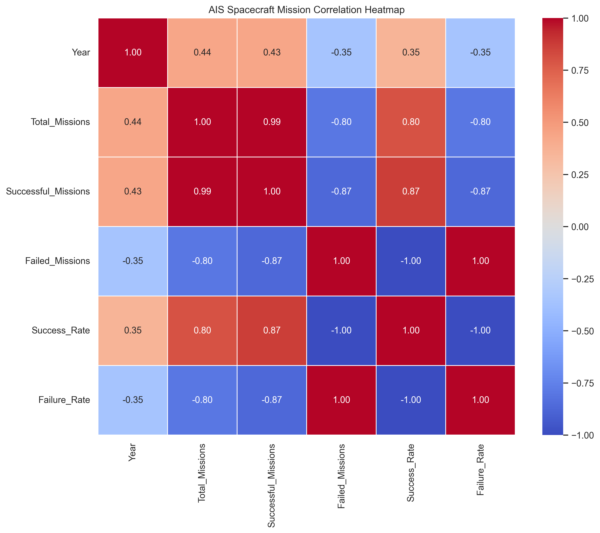

## AIS Actual vs Fitted Results

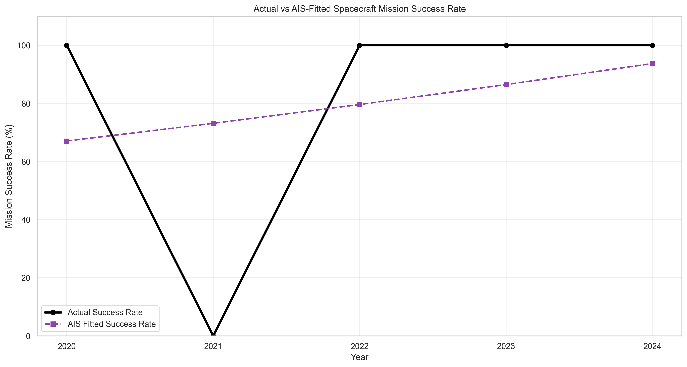

## AIS Historical Mission Results


## AIS Experimental Forecast

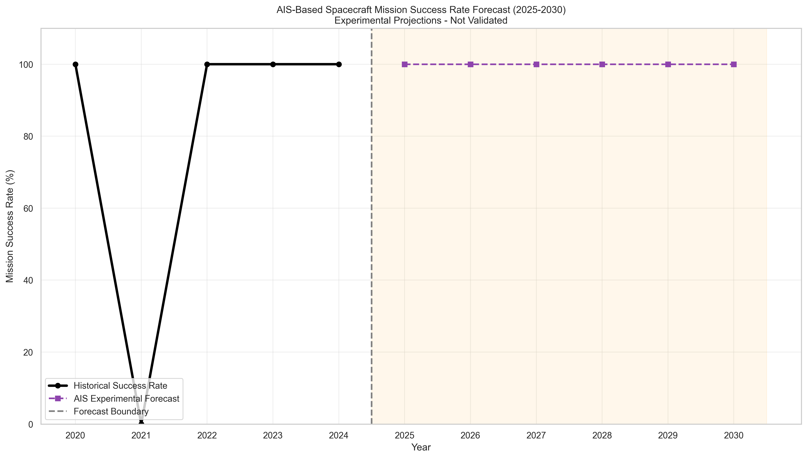

---

# PSO Results and Visualizations

## PSO Optimization Performance

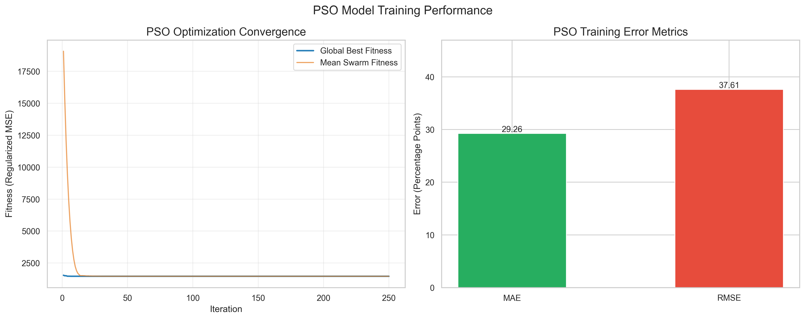

**Figure 7:** PSO optimization convergence and training error metrics.

## PSO Correlation Heatmap


## PSO Actual vs Fitted Results

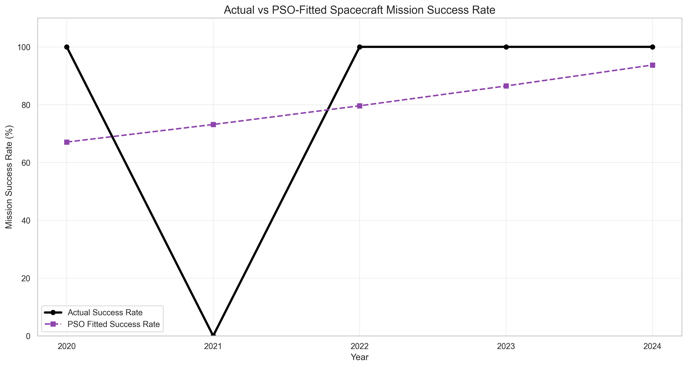

## PSO Historical Mission Results


## PSO Experimental Forecast

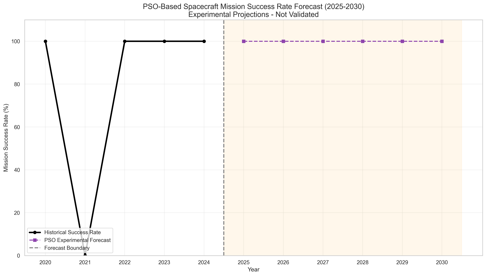

---

# Generated Output Files

## Machine Learning and Deep Learning

| File | Description |
|------|-------------|
| spacecraft_model.pkl | Random Forest model |
| spacecraft_model.h5 | Deep learning model |
| spacecraft_scaler.pkl | Neural network input scaler |
| config.yaml | Model configuration |
| metadata.json | Dataset and model metadata |
| accuracy_graph.png | Training performance comparison |
| heatmap.png | Correlation heatmap |
| comparison_graph.png | Actual vs fitted success rates |
| result.csv | Historical analysis results |
| result_graph.png | Historical mission counts |
| prediction.csv | Experimental forecasts |
| prediction_graph.png | Forecast visualization |

## Artificial Immune System

| File | Description |
|------|-------------|
| ais_model.pkl | AIS-optimized model |
| ais_config.yaml | AIS parameters |
| ais_metadata.json | AIS metadata |
| ais_accuracy_graph.png | AIS optimization performance |
| ais_heatmap.png | Correlation heatmap |
| ais_comparison_graph.png | Actual vs AIS-fitted values |
| ais_result.csv | Historical AIS results |
| ais_result_graph.png | Historical mission visualization |
| ais_prediction.csv | Experimental AIS forecasts |
| ais_prediction_graph.png | AIS forecast visualization |

## Particle Swarm Optimization

| File | Description |
|------|-------------|
| pso_model.pkl | PSO-optimized model |
| pso_config.yaml | PSO parameters |
| pso_metadata.json | PSO metadata |
| pso_accuracy_graph.png | PSO optimization performance |
| pso_heatmap.png | Correlation heatmap |
| pso_comparison_graph.png | Actual vs PSO-fitted values |
| pso_result.csv | Historical PSO results |
| pso_result_graph.png | Historical mission visualization |
| pso_prediction.csv | Experimental PSO forecasts |
| pso_prediction_graph.png | PSO forecast visualization |

---

# Applications

## 1. Space Mission Data Analysis

Provides a framework for analyzing historical spacecraft mission performance.

## 2. Machine Learning Education

Demonstrates regression modeling, preprocessing, and evaluation.

## 3. Bio-Inspired Optimization Research

Illustrates how Artificial Immune Systems can optimize model parameters.

## 4. Swarm Intelligence Research

Demonstrates Particle Swarm Optimization for continuous regression parameter search.

## 5. Data Visualization

Produces graphical representations of mission statistics and model outputs.

## 6. Experimental Forecasting

Provides a framework for investigating future trends using statistical and machine learning models.

---

# Limitations

## 1. Small Dataset

The dataset contains only five annual records.

This is insufficient for reliable model validation.

## 2. Limited Input Features

The models use year as the predictive feature.

Important mission-specific characteristics are unavailable.

## 3. Training-Only Evaluation

The current implementation calculates evaluation metrics on the training dataset.

Therefore, these metrics should not be interpreted as independent predictive accuracy.

## 4. Incomplete 2024 Observation

The 2024 data is reported through December 10 rather than the complete calendar year.

## 5. Uncertain Future Predictions

Predictions for 2025–2030 are experimental.

Polynomial extrapolation and neural network extrapolation can produce unstable results.

## 6. No Mission-Level Classification

The project models annual success rates.

It does not classify the success or failure of individual spacecraft missions.

## 7. Correlation Does Not Imply Causation

Relationships observed in the correlation heatmap should not be interpreted as causal effects.

---

# Future Scope

The project can be extended through the following improvements.

## 1. Larger Dataset

Collect additional historical mission records covering multiple decades.

## 2. Mission-Level Features

Include:

- Launch vehicle
- Mission destination
- Mission category
- Launch year
- Space agency
- Payload characteristics
- Mission duration
- Mission outcome

## 3. Advanced Machine Learning

Investigate:

- Gradient Boosting
- XGBoost
- Support Vector Machines
- Logistic Regression for mission-level outcomes

## 4. Advanced Deep Learning

Explore neural network architectures when sufficient data becomes available.

## 5. Hybrid Optimization

Investigate:

- AIS-PSO Hybrid Optimization
- PSO-Optimized Neural Networks
- AIS-Based Feature Selection
- Multi-objective Optimization

## 6. Independent Model Validation

Use chronological holdout evaluation, time-series cross-validation, or other appropriate validation strategies.

## 7. Interactive Dashboard

Develop a dashboard using Streamlit or Flask.

## 8. Explainable AI

Use feature importance and explainability techniques to study model behavior.

## 9. Uncertainty Estimation

Generate prediction intervals and quantify forecasting uncertainty.

## 10. Real-Time Data Integration

Connect the application to regularly updated spacecraft mission datasets.

---

# Conclusion

The AI-Based Spacecraft Mission Success Analysis and Prediction project demonstrates the application of Machine Learning, Deep Learning, Artificial Immune Systems, and Particle Swarm Optimization to historical spacecraft mission data.

The project successfully establishes a workflow for:

- Data preprocessing
- Historical success-rate analysis
- Machine learning model development
- Deep learning model development
- AIS-based parameter optimization
- PSO-based parameter optimization
- Model training evaluation
- Experimental forecasting
- Data visualization
- CSV and model export

The main contribution is a comparative educational framework for studying conventional machine learning and nature-inspired optimization techniques.

Due to the limited dataset, the project should be viewed as a proof-of-concept analytical and experimental forecasting system.

With additional mission-level data and independent validation, the methodology could be extended toward more reliable predictive modeling.

---

# License

No license has been specified for this project.

Before publicly distributing the source code or dataset, verify the dataset's usage rights and select an appropriate software license.

---

# Project Information

**Project Title:** AI-Based Spacecraft Mission Success Analysis and Prediction

**Domain:** Artificial Intelligence, Machine Learning, Space Technology, Data Analytics

**Algorithms:** Random Forest, Artificial Neural Network, AIS, PSO

**Programming Language:** Python

**Dataset Period:** 2020–2024

**Experimental Forecast Period:** 2025–2030

**Project Type:** Academic Research / Machine Learning / Optimization / Data Analysis

---

**Note:** All visualization images are referenced using relative paths. Run the corresponding Python scripts to generate the PNG files before viewing the README on GitHub.
